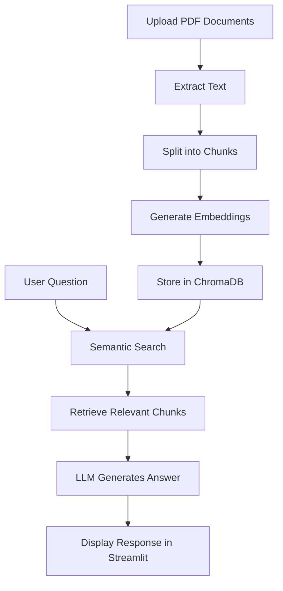

# 📄 PaperPilot — AI-Powered PDF Research Assistant

PaperPilot is a **Retrieval-Augmented Generation (RAG) chatbot** that allows users to upload multiple PDF documents and interact with their content through natural-language questions. Built with LangChain, ChromaDB, and Streamlit, it uses semantic search to retrieve relevant information and generate context-aware responses.

Instead of manually searching through lengthy documents, PaperPilot helps you find information, understand complex concepts, and extract relevant insights from your PDFs.

## ✨ Features

- **📚 Multiple PDF Uploads:** Upload multiple PDF documents in a single session.
- **💬 Conversational Question Answering:** Ask questions about the content of your uploaded documents.
- **🔍 Semantic Search:** Retrieve relevant document chunks using vector embeddings and similarity search.
- **🧠 RAG Pipeline:** Combine retrieved document context with a language model to generate relevant answers.
- **⚡ Interactive Web Interface:** Use a simple and intuitive interface powered by Streamlit.
- **📑 Document Processing:** Extract text from PDFs, split it into manageable chunks, and prepare it for retrieval.
- **🤖 LLM Integration:** Use LangChain integrations to connect the retrieval pipeline with a compatible language model.

## 🛠️ Tech Stack

| Technology | Purpose |
|---|---|
| Python | Core programming language |
| Streamlit | Interactive web interface |
| LangChain | RAG pipeline and LLM orchestration |
| ChromaDB | Vector storage and similarity search |
| Hugging Face Embeddings | Convert text into vector representations |
| Groq / Compatible LLM | Generate responses from retrieved context |
| PyPDF | Extract text from PDF documents |
| python-dotenv | Load environment variables |

*The exact LLM provider, embedding model, and installed integrations depend on your project configuration.*

## 🏗️ How It Works

PaperPilot follows a Retrieval-Augmented Generation workflow:

1. **Upload PDFs:** The user uploads one or more PDF documents through the Streamlit interface.
2. **Extract Text:** PDF loaders extract the text from each document.
3. **Split Documents:** The extracted text is divided into smaller, overlapping chunks.
4. **Generate Embeddings:** An embedding model converts the chunks into numerical vectors.
5. **Store Vectors:** ChromaDB stores the embeddings and associated document content.
6. **Retrieve Relevant Context:** When the user asks a question, semantic similarity search retrieves relevant chunks.
7. **Generate an Answer:** The language model uses the retrieved context to formulate a response.



## 📂 Project Structure

```text
PaperPilot/
├── apps/
│   └── PaperPilot.py       # Streamlit application
├── requirements.txt        # Python dependencies
├── .gitignore              # Files excluded from Git
├── .env                    # Local environment variables (not committed)
└── README.md               # Project documentation
```

> The structure above reflects the main files and folders currently identified for the repository. Add any additional modules, configuration files, or data directories that exist in your local project.

## 🚀 Getting Started

### Prerequisites

Make sure you have the following installed:

- Python 3.10 or a compatible version supported by your dependencies
- pip
- Git (optional, for cloning the repository)
- An API key for your configured language model provider, if required

### 1. Clone the Repository

```bash
git clone https://github.com/Krizhere/PaperPilot.git
cd PaperPilot
```

### 2. Create a Virtual Environment

**Windows:**

```bash
python -m venv .venv
.venv\Scripts\activate
```

### 3. Install Dependencies

```bash
python -m pip install --upgrade pip
pip install -r requirements.txt
```

### 4. Configure Environment Variables

Create a `.env` file in the project root and add the API key required by your configured LLM provider.

For example, if you use Groq:

```env
GROQ_API_KEY=your_groq_api_key
```

Replace the placeholder with your own API key. Never commit your `.env` file or expose API keys in source code.

### 5. Run the Application

If your Streamlit entry point is `apps/PaperPilot.py`, run:

```bash
streamlit run apps/PaperPilot.py
```

If your entry point is named differently, replace the filename with the correct path.

Streamlit will provide a local URL, usually:

```text
http://localhost:8501
```

Open the URL in your browser to use PaperPilot.

## 💻 Usage

1. Launch the PaperPilot application.
2. Upload one or more PDF documents.
3. Click **Process PDFs** to process the uploaded files.
4. Wait for document processing and indexing to complete.
5. Enter a question related to the uploaded documents.
6. Review the answer generated using the retrieved document context.
7. Ask follow-up questions to explore the documents further.

**Example questions:**

- What are the main ideas discussed in these documents?
- Summarize the methodology used in this research paper.
- Compare the approaches described in the uploaded PDFs.
- Explain a technical concept in simple terms.
- What conclusions do the authors draw?

## 🔐 Environment Variables

| Variable | Description |
|---|---|
| `GROQ_API_KEY` | API key for Groq, if Groq is your configured LLM provider |

Add other environment variables only if your implementation requires them.

## 🧩 Key Concepts

### Retrieval-Augmented Generation (RAG)

RAG combines information retrieval with language generation. Rather than relying solely on the language model's existing knowledge, PaperPilot retrieves relevant passages from the uploaded documents and supplies them as context for answering questions.

### Embeddings

Embeddings represent text as numerical vectors. They allow semantically similar text passages to be retrieved even when the wording of the question differs from the wording in the source document.

### ChromaDB

ChromaDB stores document embeddings and supports similarity-based retrieval. It helps PaperPilot find relevant document chunks for a user's query.

### LangChain

LangChain connects the document loaders, text splitters, embedding models, vector store, retriever, and language model into a coordinated application.

## ⚠️ Limitations

- Answer quality depends on document quality, retrieval relevance, and the selected language model.
- Scanned PDFs may require OCR if they do not contain extractable text.
- Large documents may increase processing time and memory usage.
- Language model responses can contain inaccuracies; verify important claims against the original PDFs.
- API-based language models may require internet connectivity and may incur usage costs.
- Vector persistence and chat-history retention depend on the application's implementation.

## 🔮 Future Improvements

- [ ] Add persistent vector storage across application sessions.
- [ ] Support additional document formats such as DOCX and TXT.
- [ ] Display source citations and page numbers for answers.
- [ ] Add chat-history management and conversation memory.
- [ ] Improve retrieval with metadata filtering and reranking.
- [ ] Add document summaries and comparative analysis.
- [ ] Support configurable chunk sizes and embedding models.
- [ ] Improve error handling and document-processing progress indicators.

## 🤝 Contributing

Contributions, suggestions, and bug reports are welcome.

1. Fork the repository.
2. Create a feature branch.
3. Implement and test your changes.
4. Submit a pull request describing your improvements.

## 📜 License

No license has been specified here. Add a `LICENSE` file and update this section if you decide to distribute the project under an open-source license.

## 👨‍💻 Author

**Krish Kumar**

- GitHub: [@Krizhere](https://github.com/Krizhere)
- Project Repository: [PaperPilot](https://github.com/Krizhere/PaperPilot)

---

*PaperPilot — Making research papers easier to explore, understand, and question.*
